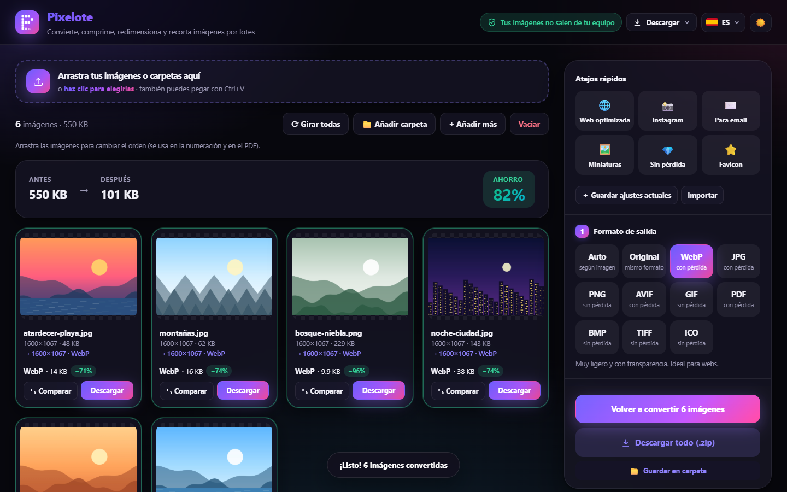
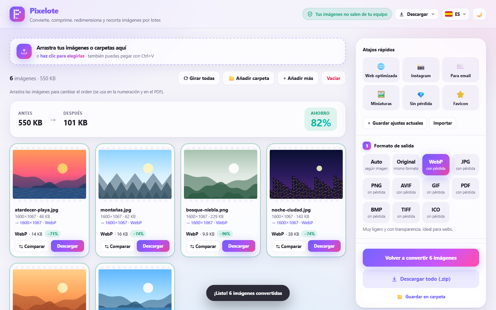
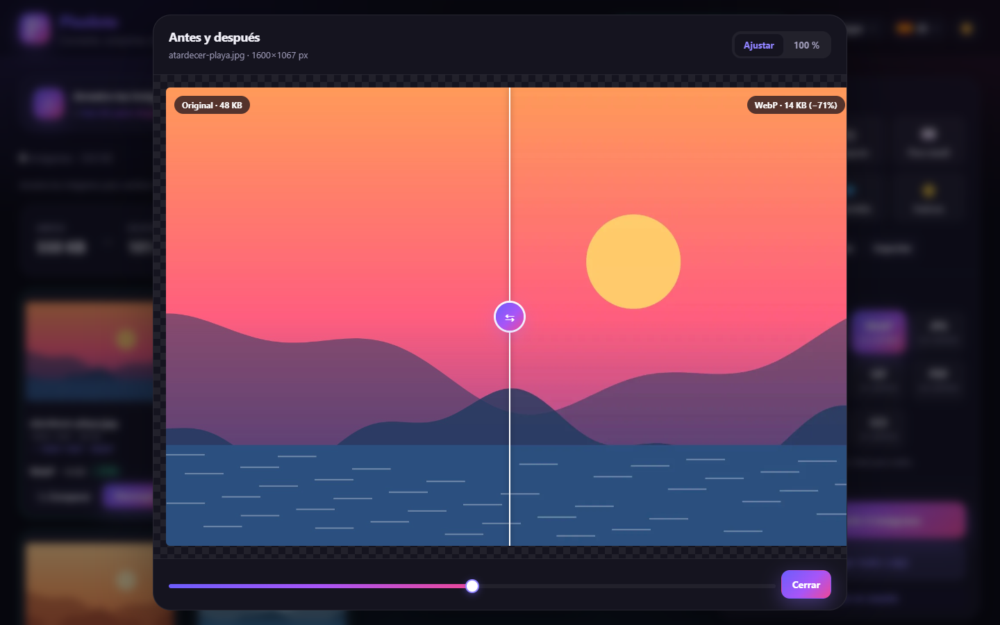
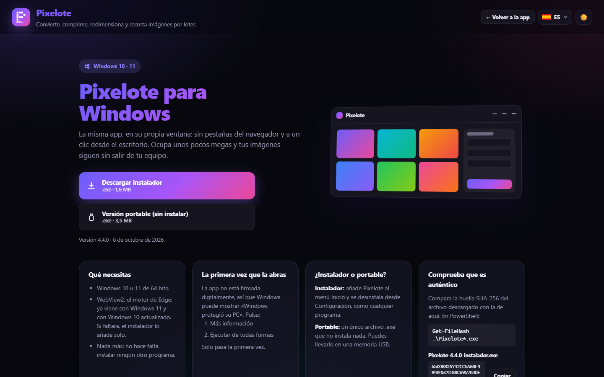
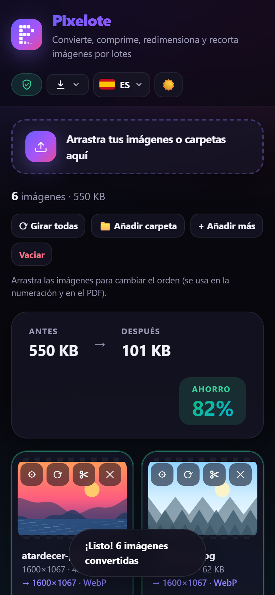
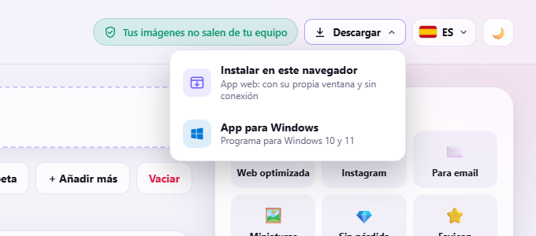

<div align="center">


# Pixelote

**Convierte, comprime, redimensiona y recorta imágenes por lotes, sin subirlas a ningún sitio.**
Todo ocurre en tu navegador: tus fotos nunca salen de tu equipo.

[](https://pixelote.de)
[](https://github.com/IamYisuSB/pixelote/releases/latest)

[](https://github.com/IamYisuSB/pixelote/releases)
[](https://github.com/IamYisuSB/pixelote/releases)


[Probarla](https://pixelote.de) · [App para Windows](https://pixelote.de/descargar/) · [Funciones](#-funciones) · [Hoja de ruta](ROADMAP.md) · [Informar de un problema](https://github.com/IamYisuSB/pixelote/issues)

<br>



</div>

## ✨ Por qué Pixelote

- 🔒 **Privada de verdad.** No hay servidor que reciba tus imágenes: se procesan en tu propio navegador.
- 📦 **Por lotes.** Arrastra decenas de fotos o carpetas enteras y conviértelas de una vez, en paralelo.
- 🧭 **Fácil.** Tres pasos: suelta las imágenes, elige el formato y pulsa *Convertir*. Los atajos rápidos lo dejan todo listo con un clic.
- ✈️ **Funciona sin conexión.** Instálala como app (PWA) o descarga la versión para Windows.
- 🆓 **Gratis, sin anuncios, sin registros y sin marcas de agua.**

## 🖼️ Capturas

<table>
  <tr>
    <td width="50%"><p align="center"><b>Modo claro</b></p></td>
    <td width="50%"><p align="center"><b>Comparador antes / después</b></p></td>
  </tr>
  <tr>
    <td width="50%"><p align="center"><b>App para Windows</b></p></td>
    <td width="50%" align="center"><p align="center"><b>También en el móvil</b></p></td>
  </tr>
</table>

## 🚀 Funciones

| | |
|---|---|
| 🔄 **Convertir** | A WebP, JPG, PNG, AVIF, GIF, PDF, BMP, TIFF e ICO, o en modo **Auto** (elige según sea foto, transparencia o gráfico) |
| 🗜️ **Comprimir** | Calidad ajustable, tamaño máximo en KB, **MozJPEG** y **PNG con paleta** optimizada |
| 📐 **Redimensionar** | Por porcentaje, ancho/alto máximo o medidas exactas, y **varios tamaños a la vez** |
| ✂️ **Recortar y girar** | Editor de recorte con proporciones, girar 90° y voltear |
| ⇆ **Comparar** | Deslizador antes/después con zoom al 100 % |
| 🏷️ **Marca de agua** | Opcional, con texto o tu logo, posición, tamaño y opacidad |
| 🛡️ **EXIF y GPS** | Conserva los metadatos o quítalos (incluida la ubicación) |
| ⚡ **Atajos** | Web, Instagram, email, miniaturas, sin pérdida, favicon… y los tuyos propios, que se pueden **compartir con un enlace** |
| ⚙️ **Ajustes por imagen** | Cada foto puede llevar su propio formato, tamaño o recorte |
| 📁 **Carpetas** | Arrastra carpetas completas y guarda el resultado en una carpeta o en un `.zip` |
| 🌗 **Tema** | Modo claro y oscuro, y diseño clásico alternativo |
| 🌍 **Idiomas** | Español, inglés, portugués de Brasil y alemán |

### Formatos

| Entrada | Salida |
|---|---|
| JPG · PNG · WebP · AVIF · GIF · BMP · SVG · ICO · **HEIC/HEIF** (iPhone) · **TIFF** · **RAW** de cámara (DNG, CR2, CR3, NEF, ARW, ORF, RW2, RAF…) | WebP · JPG · PNG · AVIF · GIF · PDF · BMP · TIFF · ICO · Auto |

## 💻 Cómo usarla

**En el navegador:** entra en **[pixelote.de](https://pixelote.de)**. Desde el botón **Descargar → Instalar en este navegador** se queda como una app más y funciona sin internet.



**En Windows:** descarga el instalador o la versión portable desde **[Releases](https://github.com/IamYisuSB/pixelote/releases/latest)** o desde la [página de descarga](https://pixelote.de/descargar/). Pesa unos 3,5 MB y no necesita instalar nada más.

**En local:** clona el repositorio y abre `index.html` con doble clic. No necesita instalación, compilación ni servidor.

```bash
git clone https://github.com/IamYisuSB/pixelote.git
cd pixelote
# Abre index.html, o sírvela para poder instalarla como app:
python -m http.server 8000   # → http://localhost:8000
```

1. Arrastra tus imágenes, haz clic para elegirlas o pégalas con <kbd>Ctrl</kbd>+<kbd>V</kbd>.
2. Elige el formato de salida o pulsa uno de los atajos rápidos.
3. Si quieres, ajusta la calidad, el tamaño o el recorte (✂ en cada imagen).
4. Pulsa **Convertir**, compara con **⇆ Comparar** y descárgalas una a una o en un **.zip**.

> [!NOTE]
> Funciona sin internet salvo la primera vez que abres un HEIC o un TIFF, generas AVIF en un navegador que no lo crea por sí mismo o usas MozJPEG: en esos casos se descarga el códec correspondiente desde jsDelivr. En *Opciones avanzadas → Descargar códecs* puedes dejarlos guardados (HEIC siempre necesita conexión, ver [Seguridad](#-seguridad)).

## 🧱 Cómo está hecha

- **JavaScript puro**, sin frameworks ni paso de compilación. Funciona incluso abierta como archivo (`file://`).
- **Canvas / OffscreenCanvas** y **Web Workers** para procesar varias imágenes en paralelo sin bloquear la página.
- **Codificadores propios** para BMP, TIFF, ICO, GIF, PDF, PNG con paleta y ZIP.
- **WebAssembly** ([jSquash](https://github.com/jamsinclair/jSquash)) para AVIF y MozJPEG.
- **PWA** con service worker para instalarla y usarla sin conexión.
- **[Tauri](https://tauri.app)** para la app de Windows, a partir del mismo código web.

## 🔐 Seguridad

<details>
<summary><b>Página</b></summary>

- **Política de seguridad de contenido (CSP):** la página solo puede ejecutar su propio código y el del CDN de los códecs, y solo puede enviar datos a Web3Forms.
- **Librerías externas verificadas:** HEIC, TIFF y pako se comprueban con su huella SHA-384 (SRI) antes de usarse; si el CDN sirviera otra cosa, se rechaza.
- **Decodificador HEIC aislado:** necesita una función (`new Function`) que la página prohíbe, así que se ejecuta en un iframe *sandbox* sin acceso a la página, al almacenamiento ni a internet. Por eso HEIC necesita conexión aunque la app esté instalada.
- **Si cambias código protegido por la CSP:** si editas el pequeño script de `<head>` (que está igual en `index.html` y `descargar/index.html`) o el de `heic-sandbox.html`, recalcula su huella `sha256` en la CSP de esos archivos, o el navegador lo bloqueará.

</details>

<details>
<summary><b>Informes de problemas</b></summary>

- El botón **🐞 Reportar un problema** del pie envía la descripción y datos técnicos: navegador, ajustes y errores recientes. Cuando la app detecta un error, muestra un aviso para enviarlo con un clic (se puede marcar *«Enviar siempre sin preguntar»*).
- Nunca incluyen imágenes, nombres de archivo ni carpetas: se sustituyen por `[archivo]`, igual que las rutas del equipo, los emails y los enlaces internos.
- Límites por navegador: 5 informes por hora, 15 al día y 3 automáticos por sesión; el mismo error no se repite en 24 horas. Una casilla oculta hace de trampa para bots y cada envío tiene tamaño y tiempo máximos.
- Llegan por **Web3Forms** (clave pública `web3formsKey` en `config.js`, que solo permite enviarte mensajes). Alternativas en `config.js`: un Worker propio (`reportEndpoint`, ver [`server/`](server/README.md)), un repositorio de GitHub (`reportGithub`) o un email (`reportEmail`).

</details>

## 🛠️ Para desarrolladores

<details>
<summary><b>Diseños</b></summary>

Hay dos diseños con el mismo HTML: **moderno** (`styles-moderno.css`, el de por defecto) y **clásico** (`styles.css`). Para ver el clásico, añade `?diseno=clasico` a la dirección (se recuerda); con `?diseno=moderno` vuelves al nuevo. Para fijar uno, cambia el `href` de `<link id="designCss">` en `index.html`.

</details>

<details>
<summary><b>App de escritorio y publicación</b></summary>

La app de Windows está en [`desktop/`](desktop/README.md) (Tauri, ~3,5 MB).

- **Para publicar una versión nueva**, ejecuta `npm run publicar` en `desktop/` (o `npm run publicar:github` para crear también la Release). Compila, copia los `.exe` a `descargas/` y actualiza `descargas/version.js`, que la página de descarga lee para mostrar la versión, el tamaño y las huellas SHA-256.
- La versión se cambia en `desktop/src-tauri/tauri.conf.json` (y en `APP_VERSION` de `app.js` para que coincida).

</details>

<details>
<summary><b>Direcciones limpias</b></summary>

Servida desde una web, la app está en `/` y la descarga en `/descargar/`, sin `index.html` a la vista; si alguien entra por `/index.html`, la barra de direcciones se limpia sola. Abierta con doble clic, los enlaces añaden `index.html` automáticamente, porque el navegador no abre las carpetas.

</details>

<details>
<summary><b>Estructura del proyecto</b></summary>

| Archivo | Contenido |
|---|---|
| `index.html` | Estructura de la página |
| `app.js` | Interfaz: carga de imágenes, ajustes, editor, comparador y reparto del trabajo entre Workers |
| `pipeline.js` | Procesado de una imagen (recorte, tamaño, codificación, EXIF); se ejecuta igual en un Worker o en la página |
| `encoders.js` | Codificadores BMP, TIFF, ICO, GIF, PDF y PNG con paleta, ZIP, EXIF, y AVIF/MozJPEG por WebAssembly |
| `decoders.js` | Lectura de HEIC, TIFF y RAW (con verificación de las librerías) |
| `heic-sandbox.html` | Compartimento aislado donde corre el decodificador HEIC |
| `i18n.js` | Traducciones (español, inglés, portugués, alemán) |
| `ui-common.js` | Selector de idioma, tema y pie de página, compartidos por las dos páginas |
| `styles-moderno.css` / `styles.css` | Diseño moderno (activo) y clásico |
| `config.js` | Configuración (clave de Web3Forms para los informes) |
| `sw.js`, `manifest.webmanifest` | App instalable y uso sin conexión |
| `descargar/`, `descargar.js`, `descargar.css` | Página de descarga de la app de Windows |
| `descargas/version.js` | Datos de la última versión publicada para Windows |
| `desktop/` | Proyecto de la app de escritorio (Tauri) |
| `server/` | Alternativa: Worker de Cloudflare que envía los informes con Resend |
| `icons/` | Logo (`logo.svg`) e iconos de la app |
| `docs/capturas/` | Capturas de este README |
| `ROADMAP.md` | Hoja de ruta |

</details>

---

<div align="center">

Hecho con 💜 por [IamYisuSB](https://github.com/IamYisuSB) · ¿Te resulta útil? Dale una ⭐ al repositorio

</div>
